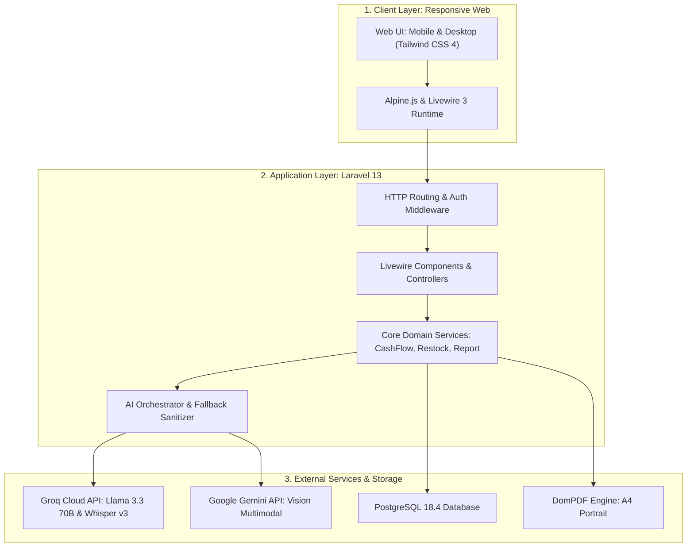
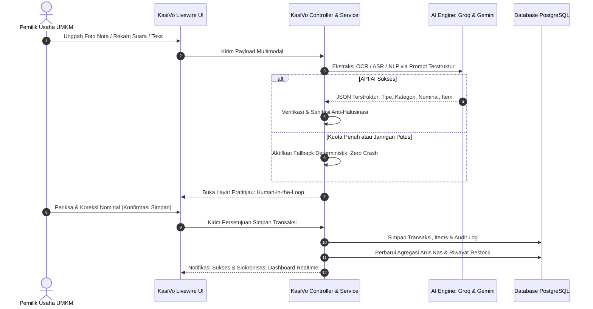
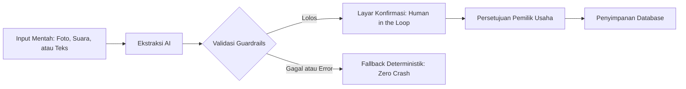

# KasiVo — Asisten Keuangan & Arus Kas Cerdas UMKM F&B
> *"Catat usaha cukup dengan foto, suara, atau tulisan biasa."*

[](https://laravel.com)
[](https://php.net)
[](https://livewire.laravel.com)
[](https://tailwindcss.com)
[](https://postgresql.org)
[](https://phpunit.de)
[](https://groq.com)

---

## 👥 1. Profil Tim Pengembang

**Nama Tim:** Niskala Team  
**Perguruan Tinggi:** Universitas Airlangga  

| No | Nama Anggota | Peran & Tanggung Jawab Utama |
| :---: | :--- | :--- |
| 1 | **Fahmi Rizki** | **Lead Backend, AI Integration & Database Architect**<br>Merancang arsitektur sistem, mesin orkestrasi AI (*multimodal parsing*), aturan arus kas, algoritma saran restock, ekspor PDF, serta pengujian otomatis (*automated testing*). |
| 2 | **Putri** | **Frontend Engineer & UI/UX Designer**<br>Merancang *design system*, riset antarmuka pengguna UMKM ramah ponsel, tata letak visual komponen Blade, dan perapian visual antarmuka. |
| 3 | **Angel** | **Frontend Engineer & UI/UX Designer**<br>Merancang interaktivitas reaktif Livewire, komponen formulir *Human-in-the-Loop*, visualisasi grafis arus kas, dan tata letak dokumen cetak PDF. |

---

## 🎯 2. Informasi Aplikasi & Problem-Solution Fit

### A. Kategori & Identitas Aplikasi
- **Kategori:** Web Application (Responsive Mobile-First Web)
- **Nama Aplikasi:** KasiVo (KasiVo-WebApp)
- **Sektor Fokus:** Usaha Mikro, Kecil, dan Menengah (UMKM) Kuliner / *Food & Beverage* (F&B)

### B. Masalah yang Diangkat (*Problem Statement*)
Sektor UMKM F&B mikro di Indonesia (seperti warung makan, kedai kopi, pedagang pecel lele, gerobakan, dan pujasera) menghadapi tiga tantangan kritis dalam operasional harian:
1. **Hambatan Pencatatan Manual (*Friction of Manual Bookkeeping*):** Pemilik usaha sibuk melayani pembeli dan mengolah masakan. Mencatat pembukuan akuntansi konvensional terasa rumit dan melelahkan, sehingga nota belanja pasar basah sering kusut, sobek, atau tercecer.
2. **Buta Arus Kas Harian (*Cash Flow Blindness*):** Pemilik usaha sering menyamakan omzet kas di laci dengan keuntungan bersih. Akibatnya, mereka tidak menyadari bahwa pengeluaran belanja bahan baku dan operasional lebih besar daripada pemasukan, yang berujung pada defisit kas mendadak.
3. **Kehabisan Stok Dapur Mendadak (*Stockout Panic*):** Tanpa pencatatan inventaris otomatis, bahan baku utama (seperti ayam, telur, beras, cabai) sering habis di tengah jam sibuk (*rush hour*), mengganggu penjualan dan mengecewakan pelanggan.
4. **Ketiadaan Profil Usaha Formal (*Credit Readines Gap*):** Pelaku usaha mikro tidak memiliki dokumen rekam jejak operasional internal yang rapi untuk evaluasi berkala maupun bahan pengajuan kemitraan formal.

### C. Deskripsi Solusi KasiVo
**KasiVo** hadir sebagai asisten keuangan dan kecerdasan perputaran arus kas digital yang mengusung prinsip **beban kognitif terendah (*zero friction*)**. KasiVo menjembatani kebiasaan alami pemilik usaha dengan teknologi kecerdasan buatan (*multimodal AI*):
- Cukup **foto bon pasar**, **rekam suara obrolan belanja**, atau **tulis kalimat percakapan santai**, AI KasiVo otomatis membedah dan mengelompokkan pos kas masuk maupun kas keluar.
- Dilengkapi **mesin analitik arus kas realtime**, deteksi pola belanja bahan baku untuk **rekomendasi restock prediktif**, serta **generator profil usaha PDF 1-klik** yang memenuhi kaidah transparansi dan privasi perbankan.

### D. Target Pengguna
- Pelaku usaha mikro dan kecil (UMKM) sektor Kuliner / F&B di seluruh Indonesia (warung makan tradisional, warkop/kedai kopi, pedagang kaki lima, katering rumahan, dan kafe rintisan).

---

## 🚀 3. Fitur Utama yang Berhasil Diimplementasikan

KasiVo dibangun melalui pendekatan modular berbasis *Software Product Specification* (SPS) dengan 7 modul fungsional penuh:

| Modul | Nama Modul & Fitur | Status | Deskripsi Fungsional |
| :---: | :--- | :---: | :--- |
| **M1 & M2** | **Autentikasi & Onboarding Usaha** | ✅ Selesai | Registrasi akun aman, verifikasi email, session management, dan onboarding profil usaha F&B (nama usaha, kategori kuliner, dan deskripsi). |
| **M3** | **AI Multimodal Catat Transaksi** | ✅ Selesai | Input transaksi pintar dengan 3 modalitas:<br>• 📸 **Foto Struk:** Ekstraksi foto nota belanja fisik menjadi item, kuantitas, harga satuan, dan total (Google Gemini 2.5 Flash Vision).<br>• 🎙️ **Suara Percakapan:** Transkripsi audio ucapan santai bahasa Indonesia menjadi entri kas (Groq Whisper Large v3).<br>• ✍️ **Teks Santai:** Parsing kalimat bebas sehari-hari menjadi transaksi terstruktur (Groq Llama 3.3 70B).<br>• 🛡️ **Human-in-the-Loop Review:** Pratinjau interaktif bagi pengguna untuk mengoreksi angka sebelum disimpan permanen. |
| **M4** | **Impor Penjualan Digital Otomatis** | ✅ Selesai | Unggah berkas CSV ekspor pesanan dari platform agregator (GoFood, ShopeeFood, GrabFood) dengan otomatisasi agregasi harian dan pencegahan duplikasi data berbasis hashing idempotency. |
| **M5** | **Dashboard Arus Kas Realtime** | ✅ Selesai | Visualisasi ringkasan kas masuk, kas keluar, arus kas bersih (*Net Cash Flow*), status surplus/defisit, dan rincian alokasi pos pengeluaran. Mendukung filter periode fleksibel (*Hari Ini*, *Minggu Ini*, *Bulan Ini*, *Tahun Ini*, *Semua Waktu*, dan *Kustom*). |
| **M6** | **Saran Restock Berbasis Pola** | ✅ Selesai | Mesin rekomendasi belanja prediktif berbasis analisis frekuensi interval pembelian 7–30 hari. Mengklasifikasikan bahan baku ke dalam 3 status urgensi (*Needs Attention*, *Upcoming*, *Safe*) disertai penjelasan naratif ramah UMKM oleh AI. |
| **M7** | **Profil Usaha & Ekspor PDF 1-Klik** | ✅ Selesai | Generator dokumen PDF standar resmi A4 Portrait (DomPDF) berisi ringkasan identitas usaha, perputaran arus kas, rincian kategori, narasi kinerja usaha oleh AI, klausul disclaimer kepatuhan resmi, serta isolasi data *multi-tenant* yang ketat (*zero data leak*). |

---

## 🛠️ 4. Teknologi & Layanan Pihak Ketiga

### A. Backend & Web Framework
- **Laravel 13 (PHP 8.4):** Framework PHP modern dengan arsitektur MVC yang kokoh, Eloquent ORM, dan proteksi keamanan tingkat tinggi (CSRF, SQL Injection prevention, XSS filtering).
- **Livewire 3 & Alpine.js:** Menghadirkan interaktivitas antarmuka yang dinamis, cepat, dan reaktif tanpa kerumitan arsitektur SPA terpisah (*no page reload*).
- **PostgreSQL 18.4:** Sistem manajemen basis data relasional kelas *enterprise* dengan dukungan integritas data ketat, pengindeksan performa tinggi, dan transaksi ACID.
- **Tailwind CSS 4:** Framework CSS utilitas untuk merancang antarmuka modern yang ringan, rapi, dan responsif di berbagai perangkat (*mobile-first*).
- **Barryvdh DomPDF:** Engine *server-side* untuk mengonversi template HTML/Blade semantik menjadi dokumen PDF berstandar cetak A4 Portrait.

### B. Artificial Intelligence (AI) & Third-Party APIs
- **Groq Cloud API:**
  - `llama-3.3-70b-versatile`: *Large Language Model* berkecepatan inferensi tinggi (~300 token/detik) untuk mengekstrak transaksi dari kalimat teks bebas, menghasilkan narasi kinerja profil usaha, dan menyusun penjelasan restock yang komunikatif.
  - `whisper-large-v3`: Model *Automatic Speech Recognition* (ASR) canggih untuk mentranskripsikan rekaman audio suara bahasa Indonesia berdialek santai.
- **Google DeepMind / Google Cloud Gemini API:**
  - `gemini-2.5-flash` / `llama-3.2-11b-vision-preview`: Model *Vision-Language* multimodal untuk memindai foto nota belanja pasar tradisional, mengenali tabel belanja, nama bahan, jumlah kuantitas, serta total nominal secara presisi.

### C. Testing & QA Framework
- **PHPUnit 12:** Framework pengujian unit dan integrasi untuk memverifikasi seluruh lapisan logika bisnis, validasi batasan waktu, kepatuhan disclaimer, dan proteksi isolasi data *multi-tenant*.

---

## 🏛️ 5. Diagram Arsitektur Sistem & Alur Data

### A. Diagram Arsitektur Sistem (High-Level Architecture)



### B. Diagram Alur Data Multimodal (Multimodal Data Flow)



---

## 💻 6. Panduan Instalasi & Konfigurasi Lingkungan

### A. Persyaratan Sistem
- **PHP:** Versi 8.3 atau 8.4 (ekstensi wajib: `pdo_pgsql`, `mbstring`, `gd`, `intl`, `curl`)
- **Composer:** Versi 2.x
- **Database:** PostgreSQL versi 15 atau lebih baru (direkomendasikan versi 17 / 18)
- **Node.js & NPM:** Versi 20.x atau 22.x
- **Git**

### B. Langkah Instalasi Langkah demi Langkah (*Step-by-Step*)

1. **Kloning Repositori:**
   ```bash
   git clone https://github.com/fahmizul/KasiVo-WebApp.git
   cd KasiVo-WebApp
   ```

2. **Instal Dependensi PHP (Composer):**
   ```bash
   composer install
   ```

3. **Instal Dependensi Frontend (NPM):**
   ```bash
   npm install
   ```

4. **Konfigurasi Berkas Lingkungan (`.env`):**
   Salin berkas template lingkungan:
   ```bash
   cp .env.example .env
   ```
   Buka berkas `.env` dan sesuaikan koneksi database serta kunci API AI.

5. **Generate Kunci Aplikasi (App Key):**
   ```bash
   php artisan key:generate
   ```

6. **Konfigurasi Database & Migrasi:**
   Pastikan database PostgreSQL telah dibuat (misal bernama `kasivo_db`), kemudian jalankan migrasi database beserta data demo:
   ```bash
   php artisan migrate --seed
   ```

7. **Hubungkan Symlink Penyimpanan Berkas:**
   ```bash
   php artisan storage:link
   ```

8. **Kompilasi Aset Frontend:**
   ```bash
   npm run build
   ```
   *(Atau jalankan `npm run dev` untuk pengembangan aktif).*

9. **Jalankan Server Lokal:**
   ```bash
   php artisan serve
   ```
   Buka browser di alamat: `http://127.0.0.1:8000`

---

### C. Daftar Variabel Lingkungan (`.env.example`) & Penjelasannya

| Nama Variabel | Nilai Default / Rekomendasi | Penjelasan & Fungsi |
| :--- | :--- | :--- |
| `APP_NAME` | `KasiVo` | Nama resmi aplikasi |
| `APP_ENV` | `local` / `production` | Lingkungan aplikasi (gunakan `production` saat rilis) |
| `APP_KEY` | *(Otomatis digenerate)* | Kunci enkripsi sesi dan data aman |
| `APP_DEBUG` | `true` (lokal) / `false` (produksi) | Mode debug (wajib `false` saat diuji juri di produksi) |
| `APP_URL` | `http://localhost:8000` | URL basis aplikasi |
| `DB_CONNECTION` | `pgsql` | Driver database relasional utama (PostgreSQL) |
| `DB_HOST` | `127.0.0.1` | Alamat server database PostgreSQL |
| `DB_PORT` | `5432` | Port standar PostgreSQL |
| `DB_DATABASE` | `kasivo_db` | Nama basis data KasiVo |
| `DB_USERNAME` | `postgres` | Nama pengguna database |
| `DB_PASSWORD` | *(Password Anda)* | Kata sandi database |
| `SESSION_DRIVER` | `database` | Penyimpanan sesi pengguna di tabel basis data |
| `GROQ_API_KEY` | `gsk_...` | Kunci API resmi Groq Cloud untuk Llama 3 & Whisper |
| `GROQ_VISION_MODEL`| `llama-3.2-11b-vision-preview` | Model Vision cadangan pada provider Groq |
| `GROQ_WHISPER_MODEL`| `whisper-large-v3` | Model Speech-to-Text resmi transkripsi suara |
| `GEMINI_API_KEY` | `AIzaSy...` | Kunci API Google Cloud / Gemini AI untuk ekstraksi nota |

---

### D. Verifikasi Pengujian Otomatis (*Test Suite*)
Seluruh fitur KasiVo telah diverifikasi dengan pengujian otomatis menyeluruh. Jalankan perintah berikut untuk menguji keandalan sistem:
```bash
php artisan test
```
**Hasil Pengujian:**
```text
Tests:    214 passed (1037 assertions)
Duration: ~50s (100% PASS, 0 Errors, 0 Failures)
```

---

## 🔑 7. Akun Demonstrasi (Siap Uji Juri)

Untuk memudahkan dewan juri dan reviewer dalam mengevaluasi aplikasi tanpa harus melakukan registrasi dan pencatatan awal, kami telah menyertakan akun demonstrasi dengan data historis pembukuan yang realistis:

- **URL Akses:** `http://127.0.0.1:8000/login` (atau URL demo produksi)
- **Email:** `demo@kasivo.id`
- **Kata Sandi (Password):** `password`

### Kondisi Data pada Akun Demo:
1. **Identitas Usaha:** `Warung Makan Berkah Bahari` (Kategori: Pecel Lele & Kuliner Nusantara).
2. **Histori Pembukuan 14 Hari Penuh:** Terdiri dari transaksi kas masuk harian konsisten (omzet ~Rp 15–20 juta), belanja berkala bahan baku (ayam, lele, cabai, minyak goreng), dan operasional gas LPG.
3. **Modul Saran Restock Aktif:** Karena data belanja sudah melebihi 7 hari dengan pola teratur, halaman `/saran-restock` langsung menampilkan daftar bahan baku yang membutuhkan tindakan belanja (*Needs Attention*), bahan yang akan habis (*Upcoming*), dan bahan yang aman (*Safe*).
4. **Log Audit AI & Unduh PDF Siap Uji:** Riwayat ekstraksi multimodal tersimpan pada log audit, dan tombol unduh laporan PDF profil usaha langsung menghasilkan dokumen resmi A4 dengan angka yang sinkron 100% dengan dashboard.

---

## 🧠 8. Dokumentasi Penggunaan AI & Etika Bertanggung Jawab

KasiVo menerapkan prinsip **Pemanfaatan AI yang Bertanggung Jawab (*Responsible & Ethical AI*)** sesuai dengan mandat kompetisi nasional:

### A. Rincian Model AI yang Digunakan
1. **Groq Cloud — Llama 3.3 70B Versatile (`llama-3.3-70b-versatile`):**
   - *Fungsi:* Mengekstrak teks masukan bahasa santai menjadi entri transaksi berformat JSON valid, merumuskan narasi ringkasan profil usaha, dan menyusun teks rekomendasi restock.
2. **Groq Cloud — Whisper Large v3 (`whisper-large-v3`):**
   - *Fungsi:* Mentranskripsikan ucapan audio pemilik usaha menjadi teks bahasa Indonesia secara presisi dengan toleransi tinggi terhadap kebisingan latar dapur/warung.
3. **Google Gemini — Gemini 2.5 Flash Vision:**
   - *Fungsi:* Mengurai foto fisik struk belanja pasar tradisional, mengoreksi teks miring/kusut, dan membedah rincian kuantitas, nama barang, serta subtotal belanja.

### B. Prinsip Etika & *Guardrails* Keamanan AI



1. **Prinsip *Human-in-the-Loop* (Persetujuan Manusia):**
   AI pada KasiVo bertindak murni sebagai **kopilot asisten pencatatan**, bukan pengambil keputusan mutlak. Sistem **tidak pernah** langsung menyimpan data transaksi ke basis data tanpa persetujuan pemilik usaha. Pengguna selalu disajikan layar konfirmasi interaktif untuk mengedit nominal, nama barang, atau kategori.
2. **Aturan Kepatuhan Anti-Halusinasi Omzet (*Anti-Hallucination Guardrails*):**
   Pada pembuatan narasi profil usaha (Modul 7), prompt sistem mengunci AI hanya pada angka aktual kas masuk, kas keluar, dan saldo kas bersih dari `CashFlowService`. AI dilarang keras mengarang proyeksi omzet fiktif di luar catatan riil pembukuan.
3. **Penafian Kelayakan Kredit Perbankan (*Strict Financing Disclaimer*):**
   Sesuai regulasi kompetisi, narasi AI disaring dengan filter `sanitizeAiNarrative()` untuk memastikan tidak ada klaim kelayakan kredit seperti *"usaha ini layak pinjaman bank"* atau rekomendasi *underwriting*. Dokumen memuat klausul penafian resmi bahwa laporan merupakan profil operasional internal mandiri.
4. **Ketahanan Sistem (*Graceful Fallbacks* Tanpa Crash):**
   Jika kuota API pihak ketiga habis atau koneksi internet terganggu, KasiVo tidak akan pernah menampilkan halaman galat (*error 500*). Sistem secara otomatis mengaktifkan *rule-engine fallback* deterministik berbasis aturan matematika internal untuk tetap menyajikan data yang akurat.

### C. Matriks Peran AI vs Logika Mandiri Tim Pengembang

| Komponen Fitur | Peran Model AI Pihak Ketiga | Logika Bisnis Mandiri Tim Pengembang |
| :--- | :--- | :--- |
| **Pencatatan Multimodal** | Mengubah format unstructured (gambar/suara/teks) menjadi format JSON terstruktur. | Menghitung subtotal item, sanitasi tipe data, validasi saldo, dan penyimpanan database. |
| **Impor Penjualan Digital** | Tidak menggunakan AI (murni parser terstruktur). | Hashing idempotency anti-duplikasi, normalisasi tanggal agregator, dan pengelompokan harian. |
| **Analisis Arus Kas** | Tidak menggunakan AI (murni kalkulasi matematis akurat). | Agregasi SQL agregat performa tinggi, kalkulasi Net Cash Flow, dan breakdown persentase kategori. |
| **Saran Restock** | Menyusun kalimat wawasan ramah UMKM berbasis pola. | Algoritma perhitungan interval belanja, aturan kecukupan data 7 hari, dan penentuan tanggal jatuh tempo. |
| **Profil Usaha PDF** | Menyusun narasi ikhtisar kinerja deskriptif 2–3 kalimat. | Kompilasi data keuangan, sanitasi kata kunci kredit, rendering DomPDF A4 Portrait, dan isolasi tenant. |

---

## 📜 9. Atribusi Aset, Dataset, dan Kode Pihak Ketiga

Seluruh aset, pustaka, dan basis data yang digunakan dalam proyek KasiVo mematuhi lisensi perangkat lunak terbuka (*open-source licenses*):

1. **Framework & Pustaka Backend:**
   - **Laravel Framework:** Hak cipta Taylor Otwell, dilisensikan di bawah [MIT License](https://opensource.org/licenses/MIT).
   - **Barryvdh Laravel DomPDF:** Dilisensikan di bawah [LGPL-2.1 License](https://opensource.org/licenses/LGPL-2.1).
   - **PHPUnit:** Dilisensikan di bawah [BSD-3-Clause License](https://opensource.org/licenses/BSD-3-Clause).
2. **Pustaka Frontend & Antarmuka:**
   - **Livewire & Alpine.js:** Dilisensikan di bawah [MIT License](https://opensource.org/licenses/MIT).
   - **Tailwind CSS:** Hak cipta Tailwind Labs Inc., dilisensikan di bawah [MIT License](https://opensource.org/licenses/MIT).
   - **Heroicons / Lucide Icons:** Koleksi ikon SVG terbuka berlisensi [MIT License](https://opensource.org/licenses/MIT).
3. **Dataset & Template:**
   - **Data Demonstrasi:** Seluruh data transaksi, profil usaha warung, dan riwayat belanja bahan baku pada `DatabaseSeeder.php` dirancang secara mandiri oleh Tim Niskala dan bersifat fiktif murni untuk simulasi realistis UMKM F&B.
   - **Template & Desain:** Seluruh komponen antarmuka, tata letak Blade, dan template dokumen PDF A4 dirancang orisinal oleh Tim Niskala tanpa menggunakan tema komersial berbayar atau bajakan.

---

<p align="center">
  <b>KasiVo — Inovasi Digital untuk Kemandirian Finansial UMKM Nusantara</b><br>
  Dikembangkan dengan ❤️ oleh <b>Niskala Team</b> — Universitas Airlangga © 2026
</p>
